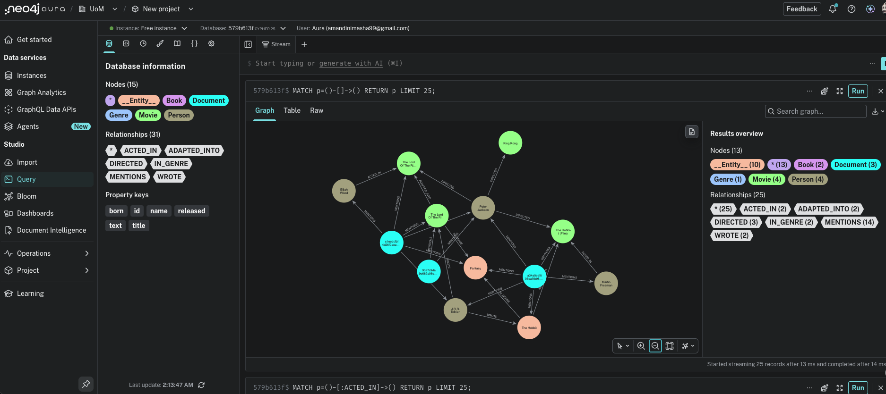
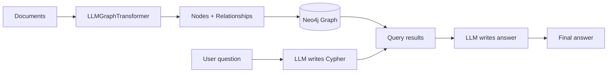

# Graph RAG with Neo4j

This folder contains a small end-to-end Graph RAG example. It extracts entities and relationships from documents, stores them in Neo4j, and uses an LLM-generated Cypher query to retrieve connected facts for a natural-language answer.

For the overview of all RAG systems in this project, see the [main README](../README.md).



## How it works



1. **Ingest:** short documents are loaded as LangChain `Document` objects.
2. **Extract:** `LLMGraphTransformer` turns documents into typed nodes and relationships.
3. **Store:** `Neo4jGraph.add_graph_documents` writes the extracted graph to Neo4j.
4. **Query:** `GraphCypherQAChain` generates Cypher from a question, runs it against the graph, and formats the result as an answer.

The sample data is about Tolkien and Peter Jackson. Shared entities connect facts across three documents:

```text
J.R.R. Tolkien --WROTE--> The Hobbit --ADAPTED_INTO--> The Hobbit (Film) <--DIRECTED-- Peter Jackson
J.R.R. Tolkien --WROTE--> The Lord of the Rings --ADAPTED_INTO--> The Lord of the Rings (Film) <--DIRECTED-- Peter Jackson
Andy Serkis --ACTED_IN--> King Kong <--DIRECTED-- Peter Jackson
```

This makes the dataset useful for multi-hop questions such as *"Who directed the film adaptations of books written by Tolkien?"*.

## Notebooks

| Notebook | Purpose |
|----------|---------|
| [`graph_rag.ipynb`](./graph_rag.ipynb) | Initial pipeline: connect to Neo4j and Groq, create and chunk a tiny movie dataset, extract and store graph data, then query it. |
| [`graph_rag_bug_fix.ipynb`](./graph_rag_bug_fix.ipynb) | Revised pipeline with a typed graph schema and custom Cypher and QA prompts to address the issues described in [Lessons learned](#lessons-learned). |

Both notebooks use environment variables from a `.env` file in the repository root. Run the cells in order. The bug-fix notebook includes a cell that clears the database before loading the sample graph; see the warning below before running it.

## Getting started

### Prerequisites

- Python 3.10 or newer
- A [Neo4j Aura](https://neo4j.com/cloud/aura/) database (the free tier works)
- A [Groq](https://console.groq.com/) API key

### Install

Clone the repository, then run these commands from its root:

```bash
git clone https://github.com/nimashaklaa/RAG.git
cd RAG

python -m venv .venv
source .venv/bin/activate        # Windows: .venv\Scripts\activate

pip install --upgrade langchain langchain-community langchain-experimental \
    langchain-groq langchain-neo4j neo4j python-dotenv jupyter
```

### Configure

Create `.env` in the repository root:

```env
NEO4J_URI=neo4j+s://<your-instance-id>.databases.neo4j.io
NEO4J_USERNAME=neo4j
NEO4J_PASSWORD=<your-password>
NEO4J_DATABASE=neo4j
GROQ_API_KEY=<your-groq-key>
```

Keep `.env` private and do not commit it.

### Run

From the repository root, start either notebook and run its cells in order:

```bash
jupyter notebook Graph_RAG/graph_rag.ipynb
# or
jupyter notebook Graph_RAG/graph_rag_bug_fix.ipynb
```

> **Database warning:** `graph_rag_bug_fix.ipynb` runs `MATCH (n) DETACH DELETE n`. This deletes every node and relationship in the configured Neo4j database, not just this example's data. Use a dedicated or empty database.

## Example questions

| Question | Example answer |
|----------|----------------|
| Which films did Peter Jackson direct? | The Hobbit, The Lord of the Rings, and King Kong |
| Which actor appeared in both King Kong and The Lord of the Rings? | Andy Serkis |
| Which books did J.R.R. Tolkien write? | The Hobbit and The Lord of the Rings |
| Who directed the film adaptations of books written by Tolkien? | Peter Jackson |
| Who directed Titanic? | I don't know based on the graph. |

The final example has no matching fact in the graph. The corrected QA prompt is designed to answer from query results only and say it does not know when the result is empty. Since extraction is LLM-based, the exact graph and answers can vary between runs.

## Lessons learned

| Problem | Cause | Fix |
|---------|-------|-----|
| "I don't know" even though the graph has data | Generated Cypher used `name` or `title`, but the extracted nodes expose an `id` property | Use a custom Cypher prompt that instructs the model to match on `id`. |
| Old relationship types or properties remain in the schema | Previous sample data was still in the database | Start with a clean, dedicated database before loading. |
| A bogus `Wood` person node appears | `chunk_size=200` split a sentence in half | Do not split tiny documents (`chunks = documents`) or use a larger chunk size. |
| A book and its film adaptation collide on an ID | `baseEntityLabel=True` applies a uniqueness constraint to `__Entity__.id` across labels, so the extractor may add suffixes such as `(Film)` | Match titles with `CONTAINS` and clean suffixes in the `RETURN`, or model book and film as one `Work` node. |
| Cypher returns rows, but the LLM still says "I don't know" | The QA prompt is too strict or query results do not explicitly phrase the answer | Tell the model the query results are the answer, and refuse only when the context is empty. |
| Answers include facts from model memory | The default QA prompt permits outside knowledge | Restrict answers to the graph query context. |
| Title matching fails due to capitalization | The extractor may change capitalization | Compare case-insensitively with `toLower()`. |

## Limitations

- Graph extraction is LLM-based, so results may vary. Inspect extracted nodes and relationships before relying on query results.
- The extractor may create duplicate nodes for one real-world entity. Entity resolution is a potential improvement.
- The query chain allows generated Cypher requests; use an isolated database and a least-privilege Neo4j user.
- `langchain-experimental` is being sunset. Pin and test dependency versions for reproducible runs.

## Stack

- [LangChain](https://python.langchain.com/) for orchestration and graph extraction
- [Neo4j](https://neo4j.com/) for graph storage and Cypher queries
- [Groq](https://groq.com/) running `openai/gpt-oss-120b` as the LLM
