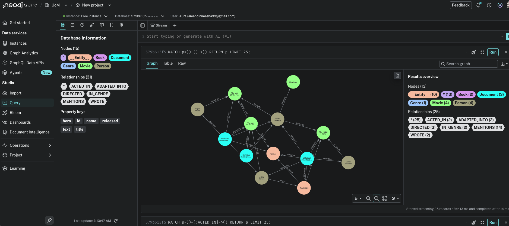

# Advanced RAG Systems

A hands-on collection of Retrieval-Augmented Generation (RAG) architectures, built step by step from simple to advanced. Each system lives in its own folder, with its own guide and runnable notebook, so you can compare approaches on the same kind of problem.

> Status: work in progress. New systems are added as they are built.

---

## Systems

| # | System | Status | Stack | What it demonstrates |
|---|--------|--------|-------|----------------------|
| 1 | [Graph RAG (Neo4j)](./Graph_RAG) | Done | LangChain, Neo4j, Groq | Turning text into a knowledge graph and answering multi-hop questions with Cypher |
| 2 | Naive RAG | Planned | | Chunk, embed, retrieve, generate baseline |
| 3 | Hybrid Search (BM25 + vector) | Planned | | Combining keyword and semantic retrieval |
| 4 | Re-ranking | Planned | | Cross-encoder re-ranking of retrieved chunks |
| 5 | Query Rewriting / Multi-Query / HyDE | Planned | | Improving the query before retrieval |
| 6 | Parent-Document Retrieval | Planned | | Retrieve small chunks, return larger context |
| 7 | Corrective RAG (CRAG) | Planned | | Grading retrieved documents and falling back |
| 8 | Self-RAG | Planned | | Model decides when to retrieve and critiques its own output |
| 9 | Agentic RAG (LangGraph) | Planned | | Agents that choose tools and retrieval strategies |
| 10 | Multimodal RAG | Planned | | Retrieval over images, tables, and PDFs |

---

## Graph RAG with Neo4j

The first implemented system extracts entities and relationships from documents, stores them in Neo4j, and uses an LLM-generated Cypher query to answer questions. It is designed to demonstrate multi-hop questions that depend on connected facts, rather than only similarity to a text chunk.



The sample data connects people, books, movies, and genres. For example, a question about who directed adaptations of books by Tolkien follows a path across author, book, movie, and director relationships.

**Explore this system:** [Graph RAG guide](./Graph_RAG/README.md) for setup, notebook walkthroughs, examples, and lessons learned.

---

## Project Structure

```
.
├── Graph_RAG/
│   ├── README.md
│   ├── graph_rag.ipynb
│   ├── graph_rag_bug_fix.ipynb
│   └── images/
│       └── complete_relationships.png
├── neo4j-graph-rag.md
├── .env                       (local configuration; not committed)
├── .gitignore
└── README.md
```

---

## Roadmap

- [x] Graph RAG with Neo4j
- [ ] Naive RAG baseline with a vector store
- [ ] Hybrid search and re-ranking
- [ ] Query transformation (multi-query, HyDE)
- [ ] Corrective and Self-RAG
- [ ] Agentic RAG with LangGraph
- [ ] Multimodal RAG
- [ ] Evaluation across systems (RAGAS or similar) on a shared question set
- [ ] Entity resolution for the graph pipeline

---

## Contributing

This is a personal learning project, but suggestions are welcome. Open an issue or a pull request.

## License

MIT. Add a `LICENSE` file if you publish the repo.