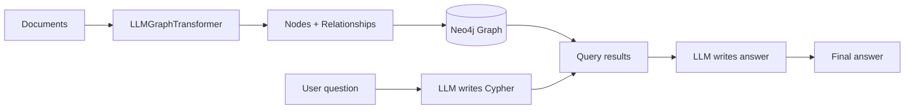

# Advanced RAG Systems

A hands-on collection of Retrieval-Augmented Generation (RAG) architectures, built step by step from simple to advanced. Each system lives in its own folder with a runnable notebook, so you can compare approaches on the same kind of problem.

> Status: work in progress. New systems are added as they are built.

---

## Systems

| # | System | Status | Stack | What it demonstrates |
|---|--------|--------|-------|----------------------|
| 1 | [Graph RAG (Neo4j)](./01-graph-rag) | Done | LangChain, Neo4j, Groq | Turning text into a knowledge graph and answering multi-hop questions with Cypher |
| 2 | Naive RAG | Planned | | Chunk, embed, retrieve, generate baseline |
| 3 | Hybrid Search (BM25 + vector) | Planned | | Combining keyword and semantic retrieval |
| 4 | Re-ranking | Planned | | Cross-encoder re-ranking of retrieved chunks |
| 5 | Query Rewriting / Multi-Query / HyDE | Planned | | Improving the query before retrieval |
| 6 | Parent-Document Retrieval | Planned | | Retrieve small chunks, return larger context |
| 7 | Corrective RAG (CRAG) | Planned | | Grading retrieved documents and falling back |
| 8 | Self-RAG | Planned | | Model decides when to retrieve and critiques its own output |
| 9 | Agentic RAG (LangGraph) | Planned | | Agents that choose tools and retrieval strategies |
| 10 | Multimodal RAG | Planned | | Retrieval over images, tables, and PDFs |

---

## 1. Graph RAG with Neo4j

Instead of searching text chunks, this system extracts **entities and relationships** from documents, stores them as a graph in Neo4j, and lets an LLM answer questions by writing Cypher queries.

This is strongest for **multi-hop questions** such as *"Who directed the film adaptations of books written by Tolkien?"*, which need to follow several connections.

### How it works



1. **Ingest:** short documents are loaded as LangChain `Document` objects.
2. **Extract:** `LLMGraphTransformer` converts each document into typed nodes (`Person`, `Book`, `Movie`, `Genre`) and relationships (`WROTE`, `DIRECTED`, `ACTED_IN`, `ADAPTED_INTO`, `IN_GENRE`).
3. **Store:** `Neo4jGraph.add_graph_documents` writes the graph to Neo4j.
4. **Query:** `GraphCypherQAChain` has the LLM generate Cypher from the question, runs it, and turns the rows into a natural-language answer.

### The sample dataset

Three small documents about Tolkien and Peter Jackson. They share entities on purpose (Tolkien, Peter Jackson, Fantasy, Andy Serkis), so the graph has real connections to traverse.

```
J.R.R. Tolkien --WROTE--> The Hobbit --ADAPTED_INTO--> The Hobbit (Film) <--DIRECTED-- Peter Jackson
J.R.R. Tolkien --WROTE--> The Lord of the Rings --ADAPTED_INTO--> The Lord of the Rings (Film) <--DIRECTED-- Peter Jackson
Andy Serkis --ACTED_IN--> King Kong <--DIRECTED-- Peter Jackson
```

### Example output

| Question | Answer |
|----------|--------|
| Which films did Peter Jackson direct? | The Hobbit, The Lord Of The Rings, King Kong |
| Which actor appeared in both King Kong and The Lord of the Rings? | Andy Serkis |
| Which books did J.R.R. Tolkien write? | The Hobbit, The Lord Of The Rings |
| Who directed the film adaptations of books written by Tolkien? | Peter Jackson |
| Who directed Titanic? | I don't know based on the graph. |

The last row is intentional: when the graph has no answer, the system refuses instead of hallucinating from the model's own knowledge.

---

## Getting Started

### Prerequisites

- Python 3.10 or newer
- A [Neo4j Aura](https://neo4j.com/cloud/aura/) database (the free tier works)
- A [Groq](https://console.groq.com/) API key

### Installation

```bash
git clone <your-repo-url>
cd <your-repo-name>

python -m venv .venv
source .venv/bin/activate        # Windows: .venv\Scripts\activate

pip install --upgrade langchain langchain-community langchain-experimental \
    langchain-groq langchain-neo4j neo4j python-dotenv
```

### Configuration

Create a `.env` file in the project root:

```env
NEO4J_URI=neo4j+s://<your-instance-id>.databases.neo4j.io
NEO4J_USERNAME=neo4j
NEO4J_PASSWORD=<your-password>
NEO4J_DATABASE=neo4j
GROQ_API_KEY=<your-groq-key>
```

> Never commit `.env`. Add it to `.gitignore`.

### Run

Open the notebook and run the cells in order:

```bash
jupyter notebook 01-graph-rag/graph_rag.ipynb
```

> Cell 3 runs `MATCH (n) DETACH DELETE n`, which **wipes the whole database**. Use a dedicated or empty Neo4j instance.

---

## Project Structure

```
.
├── 01-graph-rag/
│   └── graph_rag.ipynb
├── 02-naive-rag/              (planned)
├── 03-hybrid-search/          (planned)
├── ...
├── .env                       (not committed)
├── .gitignore
└── README.md
```

---

## Lessons Learned (Graph RAG)

Problems hit while building this, and the fixes. Useful if you adapt the pipeline to your own data.

| Problem | Cause | Fix |
|---------|-------|-----|
| "I don't know" even though the graph has data | The generated Cypher used `name` / `title`, but `LLMGraphTransformer` only stores an `id` property | Custom Cypher prompt that says to match on `id` only |
| Leftover `born`, `released`, `ACTED` in the schema | Old sample data already in the database | Clear the database before loading |
| Bogus `Wood` person node | `chunk_size=200` split a sentence in half | Skip splitting for tiny documents (`chunks = documents`) or use a larger `chunk_size` |
| Hobbit book and film collided on the same id | `baseEntityLabel=True` creates a uniqueness constraint on `__Entity__.id` across all labels, so the extractor adds suffixes like `(Film)` | Match titles with `CONTAINS` and strip suffixes in the Cypher `RETURN`, or model book and film as one `Work` node |
| Correct Cypher results, but the LLM still says "I don't know" | QA prompt too strict, and the bare list of titles did not mention the director | Tell the model "the results ARE the answer" and refuse only when the context is exactly `[]` |
| Answers that came from the LLM's memory, not the graph | Default QA prompt allows outside knowledge | Strict QA prompt: answer from context only |
| Case mismatch (`Lord of the Rings` vs `Lord Of The Rings`) | Extractor re-capitalises titles | Compare with `toLower()` |

### Known limitations

- Extraction is LLM-based, so results can vary slightly between runs. Always print and check the extracted nodes before querying.
- The extractor may create duplicate nodes for the same entity (for example two Lord of the Rings film nodes). Entity resolution is a good future improvement.
- `langchain-experimental` is being sunset. The code still works, but pin your versions.

---

## Tech Stack

- [LangChain](https://python.langchain.com/) for orchestration
- [Neo4j](https://neo4j.com/) for graph storage and Cypher queries
- [Groq](https://groq.com/) running `openai/gpt-oss-120b` as the LLM

---

## Roadmap

- [x] Graph RAG with Neo4j
- [ ] Naive RAG baseline with a vector store
- [ ] Hybrid search and re-ranking
- [ ] Query transformation (multi-query, HyDE)
- [ ] Corrective and Self-RAG
- [ ] Agentic RAG with LangGraph
- [ ] Multimodal RAG
- [ ] Evaluation across systems (RAGAS or similar) on a shared question set
- [ ] Entity resolution for the graph pipeline

---

## Contributing

This is a personal learning project, but suggestions are welcome. Open an issue or a pull request.

## License

MIT. Add a `LICENSE` file if you publish the repo.