# Neo4j for Graph RAG: How It Differs from Pinecone

Most RAG systems retrieve text by similarity. That works until a question depends on how things are connected. This article explains how Neo4j solves that, using five core concepts and its query language, Cypher. It also compares Neo4j with a typical Pinecone setup.

---

## 1. What Is Embedding?

An embedding turns text into a list of numbers. Texts with similar meaning get numbers that sit close together.

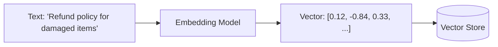

The model does not understand the text the way you do. It only places similar meanings near each other in number space.

---

## 2. How Normal RAG Works (Pinecone)

Pinecone is a managed vector database. It stores embeddings and returns the closest matches to a query.

**Indexing:**

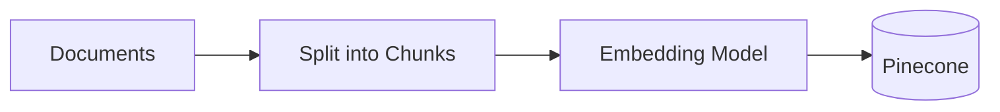

**Querying:**

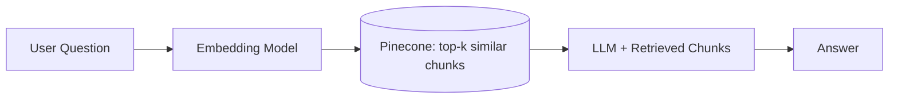

**Where it works well:**

- Semantic search over documents
- FAQ and support bots
- Simple "find the relevant paragraph" questions

**Where it breaks:**

- Chunks are isolated. Pinecone does not know that Chunk A is related to Chunk B.
- Questions like "Which suppliers are affected if Factory X shuts down?" need connected facts. Similarity search returns text that sounds related, not facts that are linked.

---

## 3. What Is Neo4j?

Neo4j is a graph database. It stores data as things and the connections between them, not as rows or vectors. Its model is called a **property graph**, built from five concepts.

### The Five Concepts

| Concept | What It Is | Example |
|---|---|---|
| **Node** | An entity | A person, a company, a product |
| **Label** | The category of a node | `Person`, `Company` |
| **Property** | A key-value detail on a node or relationship | `name: "Asha"`, `since: 2021` |
| **Relationship** | A named connection between two nodes | `WORKS_AT`, `SUPPLIES` |
| **Direction** | Which way the relationship points | Person → Company |

### How They Fit Together

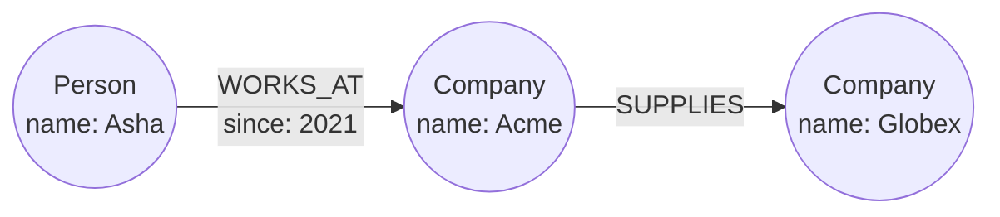

- Each circle is a **node**.
- `Person` and `Company` are **labels**.
- `name` and `since` are **properties**.
- `WORKS_AT` and `SUPPLIES` are **relationships**.
- The arrow shows **direction**. "Asha works at Acme" is not the same as "Acme works at Asha."

---

## 4. Relationship Types

A relationship type is the name that says how two nodes are connected. Every relationship has exactly one type and one direction. Neo4j has no fixed list. You define the types.

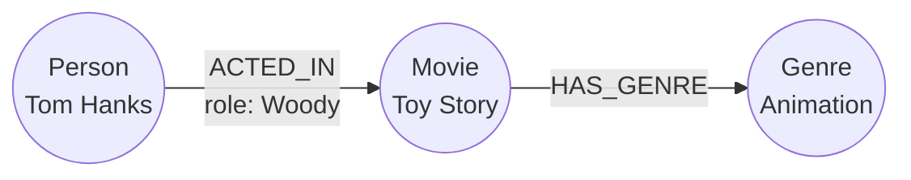

- `ACTED_IN` points from `Person` to `Movie`.
- `HAS_GENRE` points from `Movie` to `Genre`.
- `role: Woody` is a property on the relationship, not on either node.

### Common Types by Domain

| Domain | Relationship Types |
|---|---|
| **Movies** | `ACTED_IN`, `DIRECTED`, `PRODUCED`, `WROTE`, `RATED`, `HAS_GENRE` |
| **Company data** | `WORKS_AT`, `REPORTS_TO`, `MANAGES`, `FOUNDED`, `OWNS` |
| **Supply chain** | `SUPPLIES`, `SHIPS_TO`, `MANUFACTURES`, `DEPENDS_ON` |
| **Social network** | `FRIENDS_WITH`, `FOLLOWS`, `LIKES`, `POSTED`, `COMMENTED_ON` |
| **E-commerce** | `PURCHASED`, `VIEWED`, `CONTAINS`, `BELONGS_TO`, `SOLD_BY` |
| **Fraud detection** | `TRANSFERRED_TO`, `USES_DEVICE`, `SHARES_ADDRESS`, `OWNS_ACCOUNT` |
| **Documents / RAG** | `HAS_CHUNK`, `NEXT`, `MENTIONS`, `CITES`, `PART_OF`, `AUTHORED_BY` |

### Naming Rules

- **Use UPPER_SNAKE_CASE.** It separates types from labels and properties.
- **Name them as verbs.** `(Person)-[:ACTED_IN]->(Movie)` reads like a sentence.
- **Be specific.** `ACTED_IN` is better than `RELATED_TO`.
- **Put details in properties.** Use `[:ACTED_IN {role: "Woody"}]`, not `[:ACTED_AS_WOODY]`.
- **Use one name per meaning.** Do not mix `HAS_GENRE` and `IN_GENRE` in one graph.

---

## 5. Cypher: The Query Language

Cypher is Neo4j's query language. You draw the pattern you want, and Neo4j finds it in the graph. Its syntax looks like the diagrams above.

### Pattern Syntax

| Symbol | Meaning | Example |
|---|---|---|
| `( )` | A node | `(p:Person)` |
| `:Label` | The node's label | `(p:Person)` |
| `{ }` | Properties | `(p:Person {name: "Asha"})` |
| `[ ]` | A relationship | `[r:WORKS_AT]` |
| `-->` | Direction | `(a)-[:WORKS_AT]->(c)` |

Reading one pattern left to right:

```cypher
(a:Person {name: "Asha"})-[:WORKS_AT {since: 2021}]->(c:Company {name: "Acme"})
```

- `(a:Person {name: "Asha"})` is a node with label `Person` and a property.
- `-[:WORKS_AT {since: 2021}]->` is a directed relationship with a property.
- `(c:Company {name: "Acme"})` is the target node.

### Core Clauses

| Clause | Purpose |
|---|---|
| `CREATE` | Add nodes and relationships |
| `MATCH` | Find a pattern in the graph |
| `WHERE` | Filter the matches |
| `RETURN` | Choose what to output |
| `MERGE` | Create only if it does not already exist |
| `SET` | Add or update properties |
| `DELETE` | Remove nodes or relationships |

### Create Data

```cypher
CREATE (p:Person {name: "Tom Hanks"})-[:ACTED_IN {role: "Woody"}]->(m:Movie {title: "Toy Story", year: 1995})
CREATE (m)-[:HAS_GENRE]->(:Genre {name: "Animation"})
```

### Find Data

```cypher
MATCH (p:Person)-[:ACTED_IN]->(m:Movie)
WHERE m.year > 1990
RETURN p.name, m.title
ORDER BY m.title
LIMIT 10
```

### Follow Multiple Hops

Chain patterns to follow several relationships in one query:

```cypher
MATCH (:Person {name: "Tom Hanks"})-[:ACTED_IN]->(m:Movie)-[:HAS_GENRE]->(:Genre {name: "Animation"})
RETURN m.title
```

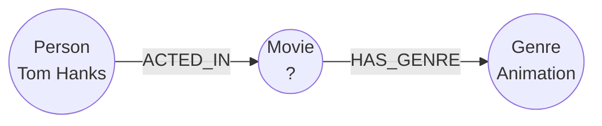

This is the pattern Neo4j matches. Each `?` node that fits becomes a result.

### Variable-Length Paths

Use `*` to follow a relationship across many hops:

```cypher
MATCH (:Company {name: "Acme"})-[:SUPPLIES*1..3]->(c:Company)
RETURN DISTINCT c.name
```

`*1..3` means one to three hops. This finds every company Acme supplies, directly or indirectly.

### Aggregate

```cypher
MATCH (p:Person)-[:ACTED_IN]->(m:Movie)
RETURN p.name, count(m) AS movies
ORDER BY movies DESC
```

### Update and Delete

```cypher
MERGE (g:Genre {name: "Drama"})

MATCH (m:Movie {title: "Toy Story"})
SET m.rating = 8.3

MATCH (m:Movie {title: "Old Movie"})
DETACH DELETE m
```

- `MERGE` avoids duplicates. Use it when loading data.
- `DETACH DELETE` removes the node and its relationships. Plain `DELETE` fails if relationships exist.

---

## 6. How Graph RAG Works

Graph RAG stores knowledge as connected facts. An LLM extracts entities and relationships from your documents and writes them into Neo4j.

There are two common ways to retrieve from the graph:

- **Vector search + traversal:** find starting nodes by similarity, then follow relationships.
- **Text-to-Cypher:** the LLM reads your graph schema and writes a Cypher query for the question.

Both are covered below. Text-to-Cypher is explained in its own 7-step flow at the end of this section.

**Indexing:**

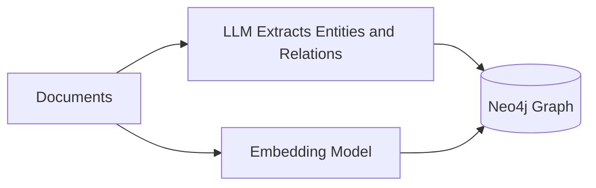

Neo4j also supports vector indexes. You can store embeddings on nodes and use similarity search too.

**A typical Graph RAG structure:**

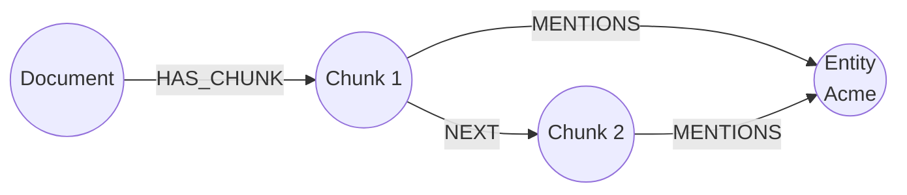

Chunks that mention the same entity are now connected. Plain vector storage cannot do this.

**Querying:**

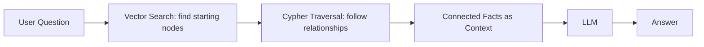

Step by step:

1. Vector search finds the nodes most relevant to the question.
2. A Cypher query follows relationships outward from those nodes.
3. The connected facts go to the LLM as context.
4. The LLM answers using facts, not only similar text.

### Vector Search + Cypher in One Query

```cypher
CALL db.index.vector.queryNodes('chunk_embeddings', 5, $question_embedding)
YIELD node AS chunk, score
MATCH (chunk)-[:MENTIONS]->(e:Entity)<-[:MENTIONS]-(related:Chunk)
RETURN chunk.text, e.name, related.text, score
```

- `queryNodes` finds the 5 chunks closest to the question.
- `MATCH` then hops to the entities those chunks mention.
- It then hops to other chunks that mention the same entities.
- The result is similar text plus connected context.

### Example Question

*"Which companies depend on Acme?"*

```cypher
MATCH (c:Company)<-[:SUPPLIES]-(:Company {name: "Acme"})
RETURN c.name
```

This returns exact answers by following relationships. A vector search can only guess from similar-sounding chunks.

### Text-to-Cypher: The 7-Step Flow

In this style, the LLM does not search by similarity. It turns the question into a Cypher query, runs it on Neo4j, and answers from the result.

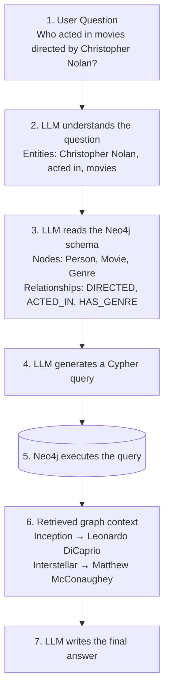

| Step | What Happens |
|---|---|
| **1. User question** | The user asks in plain language. |
| **2. Understand** | The LLM pulls out key entities and the intent. |
| **3. Read schema** | The LLM checks which labels and relationship types exist. |
| **4. Generate Cypher** | The LLM writes a query using only that schema. |
| **5. Retrieve** | Neo4j runs the query and returns matching nodes and relationships. |
| **6. Graph context** | The structured results are passed to the LLM. |
| **7. Final answer** | The LLM turns the facts into a natural language reply. |

**The schema the LLM sees (step 3):**

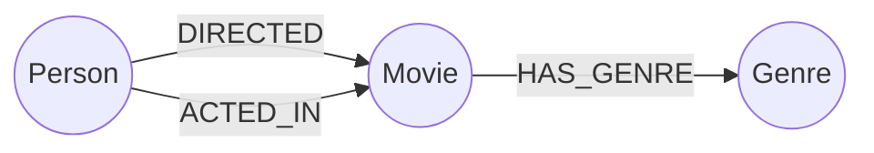

The schema tells the LLM which nodes, relationships and properties it may use. Without it, the LLM may invent labels that do not exist.

**The generated query (step 4):**

```cypher
MATCH (d:Person)-[:DIRECTED]->(m:Movie)
MATCH (a:Person)-[:ACTED_IN]->(m)
WHERE d.name = "Christopher Nolan"
RETURN m.title, a.name
```

- The first `MATCH` finds movies directed by a person.
- The second `MATCH` reuses `m` to find actors in those same movies.
- `WHERE` limits the director to Christopher Nolan.
- `RETURN` outputs movie titles and actor names.

**What Neo4j finds (step 5):**

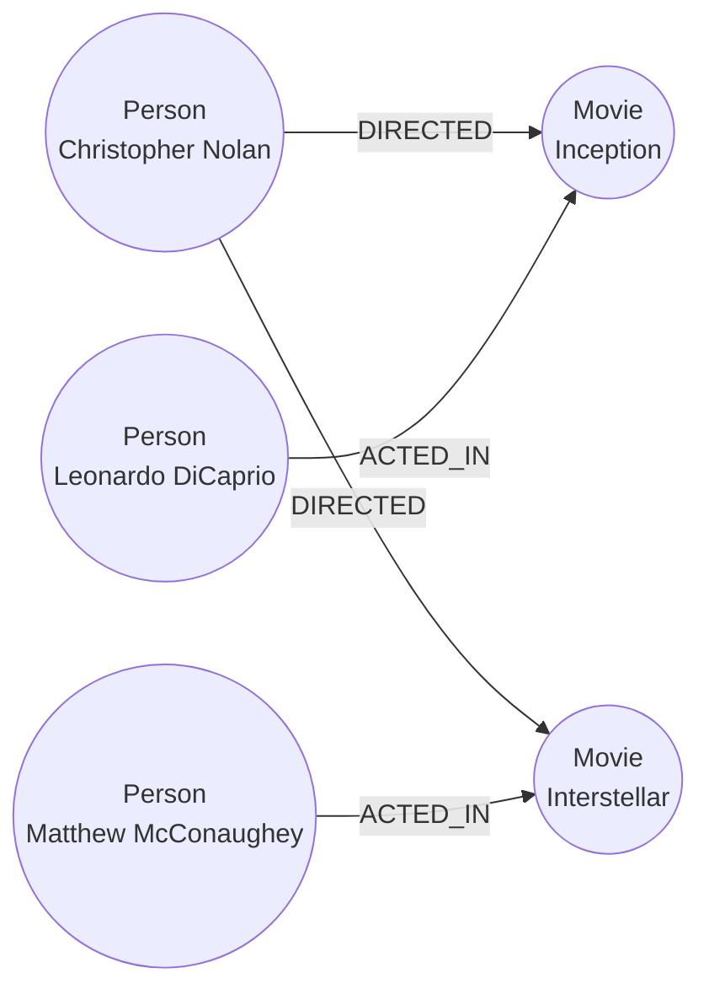

**Final answer (step 7):** Christopher Nolan directed Inception and Interstellar. Leonardo DiCaprio acted in Inception, and Matthew McConaughey acted in Interstellar.

Pinecone cannot do this. The answer needs two hops: director to movie, then movie to actor. Similarity search has no way to follow that path.

### Risks of Text-to-Cypher

- **Wrong queries.** The LLM can write Cypher that is valid but answers the wrong question.
- **Invented schema.** Always pass the real schema in the prompt.
- **Unsafe writes.** Use a read-only database user so generated queries cannot change data.
- **Silent failures.** Log every generated query so you can debug bad answers.
- **Weak on vague questions.** Pair it with vector search for questions that do not map to clear entities.

---

## 7. Pinecone vs Neo4j: Side by Side

| Aspect | Pinecone | Neo4j |
|---|---|---|
| Data model | Vectors + metadata | Nodes + relationships |
| Query method | Vector similarity API | Cypher pattern matching + vector index |
| Retrieval | Similarity search | Similarity + traversal |
| Strength | Fast semantic lookup | Connected, multi-hop reasoning |
| Relationships | Not stored | First-class, with direction |
| Explainability | Low: "these chunks are similar" | High: you can trace the path |
| Setup effort | Low | Higher: needs a schema and extraction |
| Best for | Document Q&A, FAQs | Knowledge graphs, supply chains, fraud, org data |

---

## 8. Which Should You Use?

- **Use Pinecone** when answers live inside a single chunk of text.
- **Use Neo4j** when answers depend on how entities connect.
- **Use both** when you need semantic search and relationship reasoning. Neo4j's vector index can cover both in one system.

---

## Key Takeaways

- Embeddings capture meaning. Graphs capture structure.
- Neo4j's model is five concepts: node, label, property, relationship, direction.
- Relationship types are verbs you define, written in UPPER_SNAKE_CASE.
- Cypher lets you draw a pattern and match it: `()` for nodes, `[]` for relationships, `->` for direction.
- Pinecone finds similar text. Neo4j finds connected facts.
- Graph RAG combines vector search and Cypher traversal to give LLMs precise, traceable context.
- In text-to-Cypher, the LLM reads the schema, writes a query, and answers from the graph result.
- Always give the LLM the real schema and a read-only connection.
